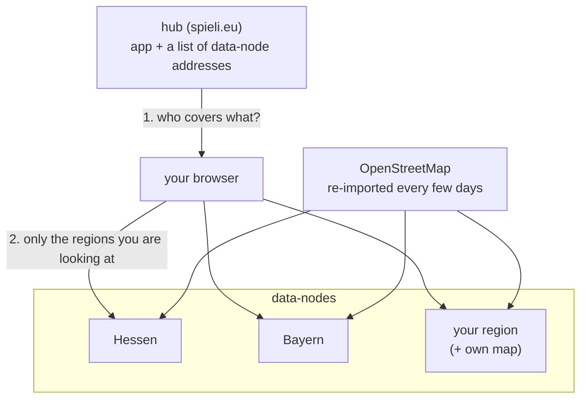

# Federation: one map, many owners

[spieli.eu](https://spieli.eu) shows playgrounds across Germany on one map. The map itself, the **hub**, holds none of them.

Every region comes from its own server, a **data-node**. The hub is little more than a list of those servers. When you open the map, your browser asks the data-nodes for the region you are looking at and puts the answers together on screen. Who runs a data-node, and where, makes no difference to the map: any server that speaks the same API can be on the list.

This page explains why spieli is built that way, and what follows from it. If you want to set one up, go to [Host a Region](../getting-started/host-a-region.md) or [Federated Deployment](../ops/federated-deployment.md) instead.

## The picture

## What makes this work

### The hub owns nothing

The hub has no database. Its whole knowledge of the world is a [`registry.json`](../reference/registry-json.md): a name, an address and a short slug per region. Everything you see on the map is fetched live from the region that holds it.

That means there is no central copy of the data to keep in sync, to back up, or to lose. Moving a region to another server, or to another operator, means changing one address in that list.

### Every region belongs to whoever runs it

A data-node is run by someone who cares about that region: a local OpenStreetMap group, a municipality, a family association, or one person with a small server. They choose the boundary, they decide when to join, and they can leave again. Their server, their imprint, their responsibility for exactly their own part, nothing more.

### Joining gives you something, rather than taking something

A data-node can also serve its own map under its own name (`data-node-ui`). Someone covering Austria could run `my-playground-map.at` for people there and appear on spieli.eu at the same time, from the same server and the same data. Taking part in the shared map does not mean giving up your own.

### Start small, grow from below

A region does not have to be a country. A state, a district or a single city is enough, and neighbours can add the areas around it later. A small VPS carries even a large state; the import is the only demanding moment. Measured figures: [Sizing](../reference/sizing.md).

### One program, different roles

There is no separate "hub software" and "node software". Hub, data-node and a stand-alone regional map are the same spieli release with a different setting (`DEPLOY_MODE`, `APP_MODE`). Anything new in spieli reaches every role with the same upgrade, and anyone who can run one part can run all of them. See [Deployment modes](../reference/deployment-modes.md).

### A failure stays local

If one data-node goes down, only its region is missing. The hub draws it as an *offline* ring and every other region keeps working. The same goes for a region that is in the middle of a re-import: it shows as *updating* instead of disappearing. See [Federation reference → Ring states](../reference/federation.md#ring-states).

This holds per data-node, not per machine: data-nodes that share a server also share its outages.

### It stays fast however many regions join

Your browser only asks the data-nodes whose area overlaps what you are looking at. A view of Berlin sends no request to a server covering Bavaria. Zoomed out to the whole country, the map draws one ring per region from numbers it already has, and asks the data-nodes only while a filter is active. Answers are drawn as they arrive, so a slow region never holds up a fast one. See [How the hub works internally](../contributing/hub-internals.md).

### The data is OpenStreetMap's, not ours

No data-node invents or edits anything. Each one re-imports its region from [OpenStreetMap](https://www.openstreetmap.org) every few days. So the way to make the map better is to improve OpenStreetMap, and every improvement reaches every map built on it, not only spieli. Federation spreads the work of *serving* the data; the data itself stays common property.

### Privacy follows the same split

Once regions are run by different people, no single operator sees every region a visitor looks at. See [Privacy by design](privacy.md).

## How it runs today

Honestly: spieli.eu is still mostly one person's server. At the time of writing, the hub and 15 German states run side by side as separate stacks on one VPS, operated by the project maintainer, with room left for the one re-import that runs at a time ([Sizing → Several regions on one host](../reference/sizing.md#several-regions-on-one-host)). The federation is real in the software, not yet in who runs it.

That is a starting point, not the plan. Each state is already its own data-node with its own database and address, so handing one over to someone else, or adding a region from somewhere else, needs no change to spieli at all. That is what [Host a Region](../getting-started/host-a-region.md) is for.

## What this asks of you

Federation is not free of cost. It moves work outward:

- **Someone has to run each region.** A region nobody hosts stays empty on the map, which is why we are [looking for hosts](../getting-started/host-a-region.md).
- **Each data-node is a public server.** It needs HTTPS, updates and, in Germany, an imprint. The installer and automatic updates keep this small, but it is not zero.
- **Regions should not overlap.** Two data-nodes covering the same area would show the same playgrounds twice. The hub drops exact duplicates and warns when one region lies entirely inside another (a partial overlap goes unflagged), but choosing boundaries is a matter of talking to each other, in [#spieli:matrix.org](https://matrix.to/#/#spieli:matrix.org).

## Where to go next

| I want to… | Go to… |
|---|---|
| Put my region on spieli.eu | [Host a Region](../getting-started/host-a-region.md) |
| Run my own hub with several regions | [Federated Deployment](../ops/federated-deployment.md) |
| Run many regions on one server | [Single-host Federation](../ops/single-host-federation.md) |
| Know exactly how the hub talks to data-nodes | [Federation reference](../reference/federation.md) |
