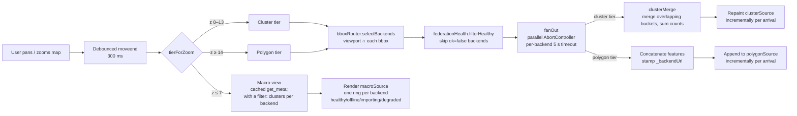

# How the hub works internally

What happens in the browser between a pan or zoom on the hub map and the rings, clusters and polygons it draws. The contract each backend has to meet (endpoints, ring states) is in the [Federation reference](../reference/federation.md); why spieli is federated at all, in [Federation: one map, many owners](../concepts/federation.md).

The Hub is designed to stay responsive with anything from two to thirty backends without any per-deployment tuning. It does this with three zoom tiers and a bbox router, so a Europe-wide viewport doesn't pull every polygon from every backend, and a city-block viewport doesn't ship a redundant continental aggregate.

## Zoom tiers

| Zoom | Tier | What ships per backend | Where the work happens |
|---|---|---|---|
| `0–7` (`≤ macroMaxZoom`) | **macro** | nothing — uses cached `get_meta`; with a filter active, `get_playground_clusters(macroMaxZoom, backend bbox)` per backend, summed into `macroFiltered` | client renders one ring per backend at the bbox centroid |
| `8–13` (`≤ clusterMaxZoom`) | **cluster** | `get_playground_clusters(z, bbox)` returns pre-aggregated buckets | server bucketing + client re-clustering across border seams |
| `14+` | **polygon** | `get_playgrounds_bbox(bbox)` returns full GeoJSON polygons | client just concatenates per-backend polygons (each tagged with `_backendUrl`) |

`macroMaxZoom` and `clusterMaxZoom` are independent config knobs (defaults 7 and 13). The macro tier is hub-only — standalone neither reads `macroMaxZoom` (the entrypoint writes it only into the hub's `config.js`) nor enters the macro tier.

## Bbox routing — only intersecting backends are queried

Every backend's `get_meta` response carries a `bbox`. On every (debounced) moveend, the Hub intersects the current viewport with each backend's bbox and only fans out to backends whose bbox intersects. A viewport over Berlin doesn't issue a request to a Köln-only backend; a viewport spanning the German-Polish border issues parallel requests to both backends.

The bboxes are refreshed on the registry poll (`HUB_POLL_INTERVAL`, default 5 minutes), so a backend that extends its OSM relation mid-session sees the change at the next poll without a hub restart.

## Fan-out and progressive render

The Hub invokes each selected backend's tier RPC in parallel via a single `AbortController`. As each backend's response arrives, the matching layer (cluster or polygon source) is repainted incrementally — a fast backend's contribution shows within ~100 ms even if a slower peer takes 2 seconds. Per-backend timeout is 5 s; a backend that exceeds it is omitted from the current tier with a one-time console warning, and the map stays interactive.

Every moveend constructs a fresh `AbortController` and aborts the previous one, so superseded fan-outs cancel their in-flight per-backend requests via the inner controller.

## Cross-backend re-clustering

At the cluster tier, two backends covering adjacent regions both ship their own bucket grids. Without re-clustering, the seam at their shared border shows as two overlapping rings. The Hub collects every backend's buckets and runs them through the same merge the standalone client uses ([Frontend Guide → Cluster buckets](frontend-guide.md#cluster-buckets-grouping-position-and-merging)), so two backends meet in a single seamless ring.

The polygon tier doesn't re-cluster — every backend's polygons render in a single vector source, each feature tagged with `_backendUrl` so selection routes back to the right backend.

At the macro tier the hub draws one ring per backend from cached `get_meta` data; which ring variant a backend gets is listed under [Ring states](../reference/federation.md#ring-states).

## Architecture flow

Each box in the cluster/polygon path runs once per moveend. Fan-out is the only step that produces network traffic; everything else is in-memory.
