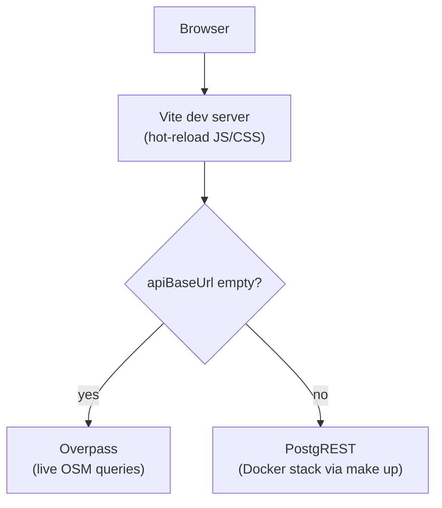

# Local Development

**Requirements:** Node.js 20.19 or newer (Vite 8 needs it; CI runs Node 20), Docker with the Compose plugin

## Start here

1. Set up the stack below, and run the tests once ([Testing Guide](testing.md)).
2. Get the picture: [Architecture](../reference/architecture.md), then [Tech Stack](../reference/tech-stack.md).
3. Read the guide for the part you will touch: [Frontend Guide](frontend-guide.md), [Import Pipeline](import-pipeline.md), or [How the hub works internally](hub-internals.md).
4. For a typical first change, follow a how-to: [Add a Playground Device](add-device.md), [Add a Sport Pitch Type](add-sport-type.md), [Add a POI Category](add-poi-category.md), [Add a Filter](add-filter.md).

**How changes get in:** open an issue first, branch from `main` as `<type>/<issue>-<short-description>`, write [Conventional Commits](https://www.conventionalcommits.org), and open a pull request against `mfuhrmann/spieli`. New UI strings go into `locales/en.json` and `locales/de.json` only; the other locale files belong to Weblate ([Translation Workflow](translations.md)). The full walkthrough: [CONTRIBUTING.md](https://github.com/mfuhrmann/spieli/blob/main/CONTRIBUTING.md).

## Setup

```bash
cp .env.example .env
make install      # install Node dependencies (once)
make up           # start db + PostgREST + nginx; on first launch it also imports
                  # Fulda Stadt (454863) from the Hessen PBF — ~300 MB download
make dev          # Vite dev server with hot-reload at http://localhost:5173
```

`make up` runs `make import` by itself when the database has no `api` schema yet. Run `make import` again later to refresh the data.

For quick testing without the download, load the bundled fixture (4 Fulda playgrounds) **before** the first `make up`. It contains the `api` schema, so `make up` then skips the import:

```bash
make seed-load
make up
```

Run `make help` to list all available targets.

`compose.yml` is this development stack, not the `compose.prod.yml` the installer sets up for operators: it always starts the database, the API and the app, plus a second database and API (`db2`, `postgrest2`) for hub testing, whatever `DEPLOY_MODE` says. To work on a different region, set `OSM_RELATION_ID` and `PBF_URL` in `.env` ([how to find them](../getting-started/quick-start.md#finding-your-region)) and run `make import`. SQL-only changes to `importer/api.sql` are applied with `make db-apply`, without a re-import.

## Repository layout

| Path | Role |
|---|---|
| `app/src/` | Svelte 5 frontend components and modules |
| `importer/` | Import script (`import.sh`: osmium filter + osm2pgsql) and PostgREST API SQL (`api.sql`) |
| `db/` | PostgreSQL schema initialisation |
| `oci/` | Docker build contexts |

For a file-by-file tour, see [Source Tree](../source-tree-analysis.md).

## Hub mode

The stack includes a second backend (`db2` / `postgrest2`) pre-wired at `/api2/`. Both backends use the Hessen PBF — the importer caches it by filename, so the second import reuses the download.

```bash
# In .env: set APP_MODE=hub (and optionally OSM_RELATION_ID / OSM_RELATION_ID2)
make docker-build
make up
make import       # imports Fulda Stadt (454863) into db  — downloads Hessen PBF (~300 MB)
make import2      # imports Neuhof (454881) into db2 — reuses cached PBF
```

With the bundled seed fixtures instead (fast, no download):

```bash
# In .env: set APP_MODE=hub
make up
make seed-load    # 4 Fulda playgrounds  → db
make seed-load2   # 5 Neuhof playgrounds → db2
make docker-build
```

`registry.json` (`app/public/registry.json`) lists both backends (`/api` = Fulda, `/api2` = Neuhof); nginx proxies each to its own PostgREST. Open `http://localhost:8080` to see the Hub with two real regions.

The second backend uses `OSM_RELATION_ID2` from `.env` (default `454881` = Neuhof). To test a different second region, set it and re-run `make import2`.

## Frontend-only (no database)

When `apiBaseUrl` is empty in `app/public/config.js`, the frontend falls back to the Overpass API — no database required for basic frontend work:

```bash
make install
make dev
```



To test against the full PostgREST backend instead, start `make up` and set `apiBaseUrl` in `app/public/config.js`.

## Testing on a phone

```bash
make lan-url
```

Prints your machine's LAN IP and ready-to-use URLs. The Vite dev server and Docker stack both bind to all interfaces, so the printed URLs work immediately on any device on the same WiFi.

!!! warning "Geolocation on mobile"
    Browsers block the geolocation API on plain HTTP. If you need to test the location button on a phone, use Chrome and enable "Insecure origins treated as secure" at `chrome://flags`, or test against the production HTTPS URL.

Without `make`, the same IP comes from:

```bash
ip route get 1 | awk '{print $7; exit}'
```

Then open `http://<that-ip>:8080` on your phone.

## Troubleshooting

### Changes don't appear

**Symptom:** You edited a JS or CSS file, but the browser still shows the old version.

**Fix:** Vite hot-reload should pick up changes automatically. If it doesn't:

1. Check the terminal running `make dev` — a build error will prevent the browser from updating.
2. Try a hard reload: `Ctrl+Shift+R` / `Cmd+Shift+R`.
3. If you changed `index.html` or a file in `public/`, stop and restart `make dev`.

When testing against the Docker stack, rebuild and restart the app container after changes:

```bash
docker compose up -d --build app   # or: make docker-build
```

See also the [operator troubleshooting page](../ops/troubleshooting.md) for problems with the Docker stack itself.

## How-to pages for generated files

- [Update Generated Assets](generated-assets.md): app icons and equipment illustrations
- [Build the Poster](poster.md)
