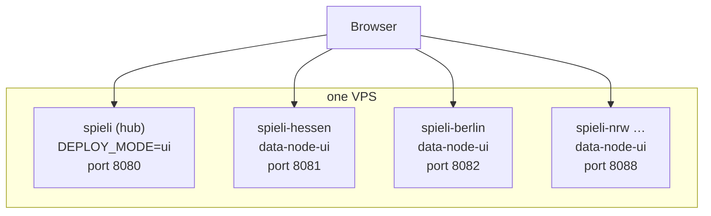

# Single-host Federation

A single-host federation runs a **pure hub** (no database) and multiple regional **data-nodes** on one VPS. It is a valid alternative to the [distributed topology](federated-deployment.md) and suits operators who want full-country coverage without coordinating multiple machines.

## Topology



The hub serves the frontend and `registry.json`. Browsers fetch playground data cross-origin from each data-node's `/api/`. The hub itself has no database and no importer.

## When to use this topology

- One operator wants to cover a large region (e.g. all of Germany) without a multi-hour single import.
- You want a live test bed for hub federation features.
- You don't (yet) have other operators to host regional backends.

## Prerequisites

### Hardware

| Resource | Minimum | Recommended |
|---|---|---|
| RAM | 6 GiB | 8 GiB |
| Swap | **4 GiB** | 4 GiB |
| Disk | 20 GiB | 40 GiB+ |

**Swap is required.** Without swap, the Linux OOM killer fires when multiple importers run near-simultaneously, killing whichever process is largest at that moment. Even if each individual import fits in RAM, two medium-sized backends starting at the same time can exhaust available memory. 4 GiB of swap gives the kernel room to page out idle data and survive the overlap.

```bash
sudo fallocate -l 4G /swapfile
sudo chmod 600 /swapfile
sudo mkswap /swapfile
sudo swapon /swapfile
echo '/swapfile none swap sw 0 0' | sudo tee -a /etc/fstab
```

### Per-backend RAM and disk

See [Sizing](../reference/sizing.md): measured memory and disk per region class, and what an import needs on top. Plan for the sum of the serving memory plus **one** import at a time, which is why imports must not overlap (see swap above and [Scheduled Import](scheduled-import.md)).

## Port allocation

| Stack | Port | Profile(s) |
|---|---|---|
| Hub | 8080 | `ui auto-update` |
| First data-node (e.g. Hessen) | 8081 | `data-node-ui` |
| Second data-node (e.g. Berlin) | 8082 | `data-node-ui` |
| … | 8083–8096 | `data-node-ui` |

Use consecutive ports and unique `COMPOSE_PROJECT_NAME` per stack.

## Setup

### Hub

The hub runs `DEPLOY_MODE=ui` with no database. Its `.env` contains no `OSM_RELATION_ID`, `PBF_URL`, or `POSTGRES_PASSWORD`:

```env
COMPOSE_PROJECT_NAME=spieli
DEPLOY_MODE=ui
APP_MODE=hub
APP_PORT=8080
REGISTRY_URL=/registry.json
HUB_POLL_INTERVAL=300
SITE_URL=https://hub.example.com
IMPRESSUM_NAME=...
IMPRESSUM_ADDRESS=...
IMPRESSUM_EMAIL=...
```

Bind-mount `registry.json` via `compose.override.yml` so you can update it without rebuilding:

```yaml
services:
  app:
    volumes:
      - ./registry.json:/usr/share/nginx/html/registry.json:ro
```

Start with `--profile ui --profile auto-update` (Watchtower lives here and covers all containers on the host):

```bash
docker compose --profile ui --profile auto-update up -d
```

### Data-nodes

Use `scripts/setup-germany-backends.sh` as a starting point for bulk setup. Edit the `SKIP_SLUGS` array for backends hosted elsewhere or not yet ready, and set `DOMAIN_SUFFIX` and `TRAEFIK_DYNAMIC_DIR` to match your environment.

For each backend the script creates the directory, patches `compose.yml`, writes `.env`, and drops a Traefik dynamic config. It does **not** start imports — do those manually after checking RAM.

### First import — one-shot before daemon

On a fresh database the daemon imports right away (after `REIMPORT_STARTUP_JITTER_MAX_HOURS`, if set); it defers the schema apply until that first import has finished (#759). On a shared host, though, you want to decide *when* each first import runs, so that two large ones never overlap. So run the first import as a one-shot (no daemon env vars), then start the daemon:

```bash
cd ~/spieli-<slug>

# 1. Start db, postgrest, app — but not importer
docker compose --profile data-node-ui up -d db postgrest app

# 2. Run one-shot import (overrides daemon env vars from .env)
docker compose --profile data-node-ui run --rm \
  -e REIMPORT_INTERVAL_MIN_DAYS= \
  -e REIMPORT_INTERVAL_MAX_DAYS= \
  -e REIMPORT_STARTUP_JITTER_MAX_HOURS= \
  importer

# 3. After success, start daemon
docker compose --profile data-node-ui up -d importer
```

Import large backends one at a time. Check `free -h` before each large one.

### Keeping imports apart

Two settings spread the imports of stacks that share a host:

- **`REIMPORT_JITTER_HOURS`** (default `6`) adds a random 0–N hours to every scheduled wait, and to an import that is already overdue when the container starts. Stacks that once imported together (after an upgrade sweep or a reboot) drift apart instead of keeping a shared slot (#882).
- **`REIMPORT_STARTUP_JITTER_MAX_HOURS`** (default `0`) delays only the **first** import on a fresh database by a random amount, so backends set up at the same time do not all import at once. It has no effect once a backend has data, so set it before the first start, not afterwards.

Neither rules out an overlap; two imports can still land close together, which is why swap is required. See [Scheduled Import → Keeping stacks from importing at the same time](scheduled-import.md#keeping-stacks-from-importing-at-the-same-time).

## Upgrading

When the hub and its data-nodes share a single VPS, use `scripts/upgrade-stacks.sh`. It handles the correct order (data-nodes first, hub last) and runs each stack sequentially to avoid OOM from concurrent importer runs.

Copy the script to the VPS once, then edit the `STACKS` array to match your port layout:

```bash
scp scripts/upgrade-stacks.sh user@vps:~/upgrade-stacks.sh
```

```bash
STACKS=(
  "$HOME/spieli-hessen:data-node-ui:8081"
  "$HOME/spieli-berlin:data-node-ui:8082"
  "$HOME/spieli:ui auto-update:8080"   # hub last
)
```

Run:

```bash
bash ~/upgrade-stacks.sh
```

Per stack, in this order — the order is the point:

1. **Pull images.**
2. **Stop the daemon importer** (data-nodes only), so it cannot race the schema
   apply. The [manual procedure](upgrade.md#manual-upgrade) says this step is not optional; the script does
   it for you.
3. **Apply `api.sql`** via a one-shot `API_ONLY=1` importer, which never
   triggers a full reimport. If it fails, the daemon importer is brought back
   up *before* the sweep aborts, so a failed run never leaves a stack with its
   importer stopped.
4. **Recreate the daemon importer** with `up -d --force-recreate`. The plain
   restart form is what left daemons running the old image during the v0.9.0
   sweep.
5. **Restart the app container** — last, so it never serves against a schema
   the database does not have yet.
6. **Verify** by polling `get_meta` for up to 180 s, treating only `200` and
   `404` as settled. Verifying before step 4 is precisely what made [#800]
   invisible: the old schema is internally consistent enough to pass.

[#800]: https://github.com/mfuhrmann/spieli/issues/800

The hub entry skips steps 2–4 automatically.

**The sweep runs one heavy job at a time** (#971). After a data-node's app is restarted and verified, the sweep waits until its importer logs `[importer] settled` — no schema rebuild or import running or imminent — before touching the next stack; a stack that was mid-import waits for that import to end, and the zero-playground safety-net reimport now runs in the foreground. It waits up to `SETTLE_TIMEOUT_MIN` (default 120) minutes per stack, then stops rather than overlap two stacks. Before, it moved on as soon as `get_meta` answered, which it does at once because the old view keeps serving during a rebuild; during the v0.12.0 sweep two stacks' rebuilds overlapped and the host ran out of memory. Combined with the daemon skipping an unchanged startup apply, a sweep of already-current stacks does no rebuild at all.

**A sweep restarts every import clock.** Recreating the daemon importer runs
its startup grace check, and every stack whose import is overdue imports right
then. Since #882 each such import first waits a random 0–`REIMPORT_JITTER_HOURS`
(default 6 h), so a sweep no longer stamps all of them into one window — but on
a memory-constrained host it is still worth checking the spread afterwards
(see [Keeping imports apart](#keeping-imports-apart)).

**A stack that is mid-import is skipped, not forced.** If `get_meta` reports
`importing: true`, the script leaves the schema alone and says so: stopping the
importer there would SIGKILL `osm2pgsql` after 10 s and leave the database
partially imported. The app is still upgraded, and the stack is listed
separately at the end — re-run the sweep for it once the import has finished.

> **The script does not touch `.env` or `compose.yml`.** A release labelled
> `requires-env-update` or `requires-compose-update` needs those applied to
> every stack **before** the sweep. It is easy to miss, because the script
> otherwise looks like the whole federation procedure.

**Verification is not fatal to the sweep.** By the time a stack is verified its images are already pulled and its containers restarted, so a failed check means the upgrade worked but the stack is not serving data yet. The script records the stack, carries on with the rest, and exits non-zero at the end listing every inconclusive one. A data-node that has never completed an import answers `404` on `get_meta` and is called out as such — expected until its first import finishes.

If the sweep does abort — a failed image pull or container start — it prints which stacks were upgraded, which one it stopped on, and that everything from there onward was not reached. Completed stacks are idempotent, so re-run after fixing the cause. One caveat it will warn you about: if a forced reimport was launched in the background before the abort, wait for it to finish first, or the next run's `API_ONLY=1` step races it on the `playground_stats` rebuild.

Standard releases with Watchtower active need no sweep — the daemon importer applies a changed `api.sql` when it restarts (an unchanged one is skipped, #971). Only [breaking-label releases](upgrade.md#breaking-label-procedures) need manual steps.

## Watchtower

Only the hub stack runs `--profile auto-update`; its Watchtower updates every stack on the host. Why: [Upgrading → One Watchtower per host](upgrade.md#automatic-upgrade-watchtower).

## See also

- [Federated Deployment](federated-deployment.md) — distributed (multi-host) topology
- [Add a Data-node](add-data-node.md) — adding one backend at a time
- [Upgrading](upgrade.md) — full upgrade guide for all deployment types
- [Configuration reference](configuration.md) — all env vars
