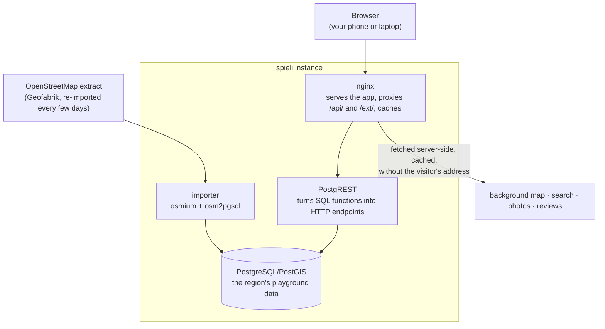
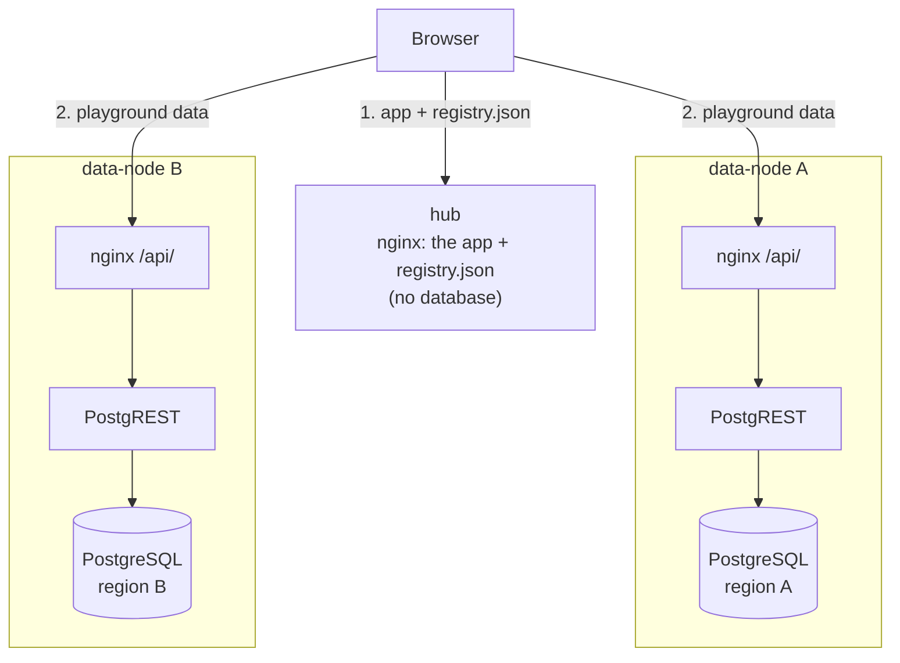

# Architecture

How the parts of a spieli instance fit together. The pages that follow build on this picture: [Federation](../concepts/federation.md) explains why regions live on separate servers, [Privacy by design](../concepts/privacy.md) why the browser talks to only one of them.

## Standalone mode (default)

One region, one database. `APP_MODE=standalone` (the default).

Your browser loads the app from nginx. When it needs playground data, it calls `/api/`, which nginx forwards to PostgREST. PostgREST runs a SQL function in PostgreSQL and returns the results as JSON — no custom server code needed. The data comes from the importer, which downloads the OpenStreetMap extract for the region, cuts the region out and loads it with osm2pgsql — on a schedule, or whenever you re-run it ([Scheduled Import](../ops/scheduled-import.md)).

Everything else the map shows (the background map, search, photos, reviews) nginx fetches from the third-party services on the visitor's behalf and caches, so the browser contacts no one but this instance. Why: [Privacy by design](../concepts/privacy.md).

## Hub mode

Multiple regional instances aggregated onto one shared map. `APP_MODE=hub`.

The browser merges the results from A and B.

The browser loads the app and `registry.json` from the hub, then fetches playground data **directly from each data-node** listed there, which is why every data-node's `/api/` must be public and send CORS headers. The hub itself never relays playground data. Why it is built this way: [Federation: one map, many owners](../concepts/federation.md). How the hub decides which data-nodes to ask: [How the hub works internally](../contributing/hub-internals.md). Setting one up: [Federated Deployment](../ops/federated-deployment.md).

## Deployment modes

Every role above is the same spieli release. Two settings decide which one a stack plays:

- **`DEPLOY_MODE`** picks which containers run: `data-node` (database, importer, API), `ui` (the app only) or `data-node-ui` (all of them).
- **`APP_MODE`** picks how the map behaves: `standalone` (one region) or `hub` (many regions from `registry.json`).

They are independent of each other: one decides *where* the code runs, the other *what* it does. The five combinations, and when to use which, are in [Deployment modes](deployment-modes.md).

## See also

- [Deployment modes](deployment-modes.md) — the five combinations and when to use which.
- [Federation reference](federation.md) — how the hub talks to data-nodes, zoom tiers and ring states.
- For developers: [Frontend Guide](../contributing/frontend-guide.md), [Import Pipeline](../contributing/import-pipeline.md), [API reference](api.md), and [Local Development → Hub mode](../contributing/local-dev.md#hub-mode) for the two-backend dev setup.
